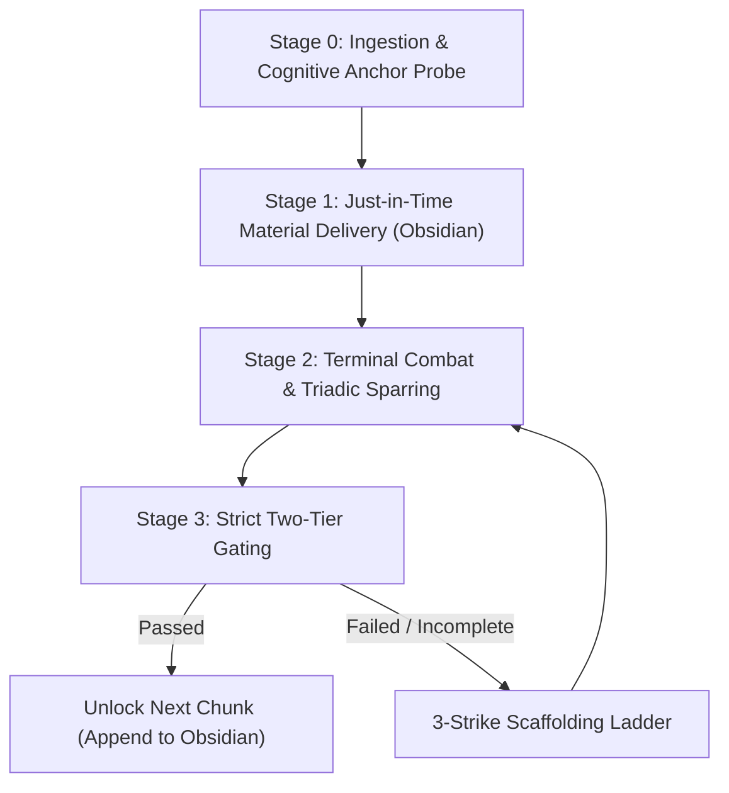

<p align="center">
  
</p>

# socrathinks

Socratic mastery learning system for technical and STEM subjects. Designed for AI coding assistants and agent runtimes, including Google Antigravity, Gemini CLI, Claude Code, and Codex.

Targeting Bloom Level 3 (*Apply*) and Level 4 (*Analyze*) competence, `socrathinks` turns an agent into an oral examiner and sparring partner. It pairs an external scratchpad in Obsidian with freeform terminal combat, replacing passive explanations, multiple-choice quizzes, and ungrounded guessing games.

---

## The Problem and Motivation

### The Illusion of Competence

Passive reading creates a false sense of understanding. When a student reads a textbook solution or watches an AI explain a concept step by step, the material seems straightforward because every individual step makes sense in isolation.

Cognitive psychology calls this the *Illusion of Competence* (Karpicke, Butler, & Roediger, 2009; Bjork, 1994). Processing finished explanations relies on recognition memory, which detects familiarity with words and symbols already on the screen. When an exam question, coding challenge, or lab task asks the student to solve a problem from scratch, recognition memory fails. Independent problem solving requires generative recollection through hippocampal and frontal brain pathways. Those pathways only develop when a student constructs derivations, algorithms, or proofs from a blank page under constraint.

### Why Multiple-Choice Questions Fail in Technical Learning

Most learning tools rely on multiple-choice questions. In technical fields, multiple-choice questions create three problems:

1. They test recognition instead of formulation. Students scan four options to spot familiar answers rather than constructing solutions from first principles.
2. They reward process-of-elimination guessing, letting students identify the right answer without understanding why it works.
3. They give away clues about scale, units, and structure that real problems never provide.

`socrathinks` bans multiple-choice prompts during study sessions. Derivations, edge cases, formulas, and explanations must be typed as freeform text or equations in the terminal.

### The Failure of Standard Socratic Bots

Most AI tutors attempt Socratic dialogue using Initiation-Response-Evaluation (IRE) patterns. The agent asks open-ended, ungrounded questions such as "What do you think happens next?"

When the learner guesses wrong, the tutor responds with hints like "Close, think about the input." The conversation becomes a guessing game where the student tries to predict what the language model wants to hear.

`socrathinks` enforces **Triadic Questioning**. Questioning does not rely on the tutor's opinion. When the student makes a claim, the examiner tests concrete boundary conditions:
- Asymptotic limits: What happens as $N \to \infty$, $x \to 0$, or $t \to \infty$?
- Edge cases: What happens with an empty array, negative numbers, or zero friction?
- System constraints: What happens when memory runs out or network packets drop?

Objective rules (conservation laws, mathematical proofs, time complexity bounds, test suite results) decide whether the answer holds.

### The Transient Information Effect in Chat Windows

In a single chat window, equations, diagrams, and definitions scroll off the screen as dialogue continues. Cognitive load theory calls this loss the *Transient Information Effect* (Sweller, 2011).

Human working memory holds four items at once (Cowan, 2001). When students must remember earlier definitions while working through a new problem, working memory clogs up and analytical performance drops.

`socrathinks` resolves this limitation with a split-screen design based on the *Extended Mind Thesis* (Clark & Chalmers, 1998):
- **Obsidian Live Notes**: Functions as an external scratchpad. It keeps the lesson roadmap, core formulas, definitions, and rendered diagrams visible in a side pane.
- **Terminal Chat**: Serves as the sparring arena, leaving working memory free for analysis and derivation.

---

## Cognitive Science Foundations

| Theory / Model | Origin | Operational Function in `socrathinks` |
|---|---|---|
| **Subsumption Theory** | David Ausubel (1968) | Stage 0 runs a 2-question probe to find the student's existing mental anchor before introducing new concepts. |
| **ICAP Framework** | Michelene Chi (2009) | Replaces passive reading with interactive cognitive sparring. |
| **Variation Theory** | Ference Marton (2006) | Tier 2 gating uses "twisted" problems, altering surface features while keeping core rules invariant. |
| **Two-Sigma Tutoring Effect** | Benjamin Bloom (1984) | Replicates 1-on-1 mastery tutoring with strict check gates before unlocking new material. |
| **Cognitive Load Theory** | John Sweller (2011) | Eliminates transient information loss by keeping state visible in Obsidian. |

---

## System Architecture

```
┌────────────────────────────────────────────────────────┐     ┌────────────────────────────────────────────────────────┐
│                 TERMINAL CHAT PANE                     │     │                  OBSIDIAN LIVE NOTE                    │
│                 (The Combat Arena)                     │     │             (<Vault>\Lessons\<Topic>.md)               │
│                                                        │     │                                                        │
│ • Cognitive Anchor Interview                           │ ──> │ • Overarching Conceptual Roadmap (Mermaid)             │
│ • Freeform derivations & equation proofs               │     │ • Just-in-Time Compact Primers (Non-destructive)       │
│ • Triadic Adversarial Stress-Testing                   │     │ • Helicopter View with Analogy Retirement Clause       │
│ • 60-Second Discriminative Structural Drills           │     │ • Clean LaTeX equations & validity limits              │
│ • Twisted Non-Routine Problem Solves                   │     │ • Python-rendered diagrams, plots, and schematics      │
└────────────────────────────────────────────────────────┘     └────────────────────────────────────────────────────────┘
```

---

## The Four-Stage Operational Workflow



### Stage 0: Ingestion and the Cognitive Anchor Probe

When the user starts a session with a topic, lecture deck, textbook chapter, or problem set, the agent:
1. Initializes the target Obsidian vault, verifies configuration, and opens `<Vault>/Lessons/<Topic>.md` in split screen.
2. Conducts a two-question interview in the terminal:
   - **The Anchor**: "Before we analyze [Topic], what related concept, formula, or algorithm do you already understand cold?" (e.g., if learning QuickSort, do they know binary search or MergeSort? If learning Bayes' Theorem, do they understand conditional probability tables?).
   - **The Litmus Test**: Asks a rapid question to verify that anchor is solid.
3. Maps a 3- to 5-node dependency tree connecting that anchor to the target mastery goal.

### Stage 1: Just-in-Time Material Delivery

The agent delivers instructional material in sequential chunks directly into the Obsidian note. It never overwrites previous sections. Each chunk adheres to a four-part structure:

1. **Helicopter View & Intuition**: One to two sentences of plain intuition, paired with an explicit **Analogy Retirement Clause** explaining where the analogy breaks down.
2. **The Cognitive Bridge**: Explains why the previous anchor falls short, creating the necessity for the new concept.
3. **Rigorous Technical Core**: Mechanisms, governing formulas or algorithms in LaTeX/code, and boundary conditions where the approach holds or fails.
4. **Visual Reference**: Diagrams, plots, or flowcharts generated via Python (`matplotlib`, `graphviz`, or domain packages) and saved to `<Vault>/Lessons/assets/`. ASCII art is prohibited.

### Stage 2: Terminal Combat and Triadic Sparring

Once the primer appears in Obsidian, the student enters the terminal arena.
- The student states their derivation, hypothesis, or explanation.
- The agent launches boundary attacks:
  - Asymptotic limits: "You claim this sorting algorithm is $O(N \log N)$. What happens when the input array is already sorted?"
  - Extreme values: "What happens to the denominator as $x \to 0$? Does the system oscillate or diverge?"
  - Inverted constraints: "Assume we cut memory from $O(N)$ to $O(1)$. Which data structure breaks first?"
- Objective mathematical, physical, or logical laws determine validity.

### Stage 3: Strict Two-Tier Gating

The agent refuses to advance to the next chunk until the learner passes two gates:

#### Tier 1: The 60-Second Discriminative Structural Drill (Zero Calculation)
The student receives a new problem and must identify the category, the optimal technique, and potential edge-case traps within 60 seconds without writing calculations or code. If the student starts crunching algebra, the examiner halts them.

#### Tier 2: The Twisted Problem Solve
The student solves a non-routine problem where surface attributes are inverted:
- Inputs and outputs are reversed (e.g., given the desired outcome, find the necessary starting conditions).
- Real-world constraints are introduced (nonzero latency, friction, finite precision, packet loss).
- Common assumptions are broken.

The student writes complete derivations or working solutions in the terminal.

---

## The Five Cognitive Safeguards

1. **Analogy Retirement Clause**: Every intuitive metaphor must state where it fails. Metaphors are never used in place of formal proofs or equations.
2. **3-Strike Progressive Scaffolding Ladder**: If a student gets stuck during sparring, the agent intervenes in three stages:
   - Strike 1: Points out the contradiction or edge-case failure.
   - Strike 2: Points to the active governing rule or equation.
   - Strike 3: Provides the intermediate transition step and asks the student to finish the solution.
3. **First-Principles Equivalence Check**: Solutions are evaluated by mathematical equivalence, dimensional units, and logic rather than exact keyword matches.
4. **60-Second Drill Purity**: Calculations and coding are barred during Tier 1 drills to isolate diagnostic recognition from mechanical computation.
5. **Tripartite Metacognitive Escape Hatch Contract**: A student cannot skip a chunk unless they document:
   - `[ESTABLISHED GROUND]`: Verified concepts they already command.
   - `[EXACT BOTTLENECK]`: The specific step or condition causing the block.
   - `[STRUCTURAL HYPOTHESIS]`: A concrete hypothesis or administrative justification (such as exam syllabus scope).

---

## Installation

### 1. Install into Your Agent Runtime

#### Antigravity / Gemini CLI
```bash
git clone https://github.com/stockfishZ/socrathinks.git ~/.gemini/config/skills/socrathinks
```

#### Claude Code
```bash
git clone https://github.com/stockfishZ/socrathinks.git ~/.claude/skills/socrathinks
```

#### Codex / AgentSkills Standard
```bash
git clone https://github.com/stockfishZ/socrathinks.git ~/.agents/skills/socrathinks
```

### 2. Install Python Dependencies

For diagram and plot generation:
```bash
pip install matplotlib
```

### 3. Optional: Configure Obsidian Vault Path

Set the `OBSIDIAN_VAULT_PATH` environment variable if your vault is located outside `~/Documents/ObsidianVault`:

```bash
# Linux / macOS
export OBSIDIAN_VAULT_PATH="$HOME/Documents/MyVault"

# Windows PowerShell
$env:OBSIDIAN_VAULT_PATH = "$HOME\Documents\MyVault"
```

---

## Usage

In your agent chat session, invoke the skill with your topic:

```
/socrathinks QuickSort Partitioning and Worst-Case Avoidance
```

Or provide a syllabus, problem set, or chapter:

```
Use /socrathinks to take me through Chapter 4 of this algorithms textbook. Hold the line on derivations.
```

The agent initializes your Obsidian split note, administers the Cognitive Anchor Probe, and opens terminal sparring.

---

## Repository Structure

```
socrathinks/
├── SKILL.md                          # Skill definition and agent instructions
├── README.md                         # Architecture, motivations, and usage guide
├── LICENSE                           # MIT License
├── assets/
│   └── cover.png                     # Visual banner
└── scripts/
    ├── sync-obsidian-lesson.ps1      # PowerShell Obsidian sync and URI launcher
    └── sync_obsidian_lesson.py       # Cross-platform Python sync and URI launcher
```

---

## License

MIT License. See [LICENSE](LICENSE) for details.
