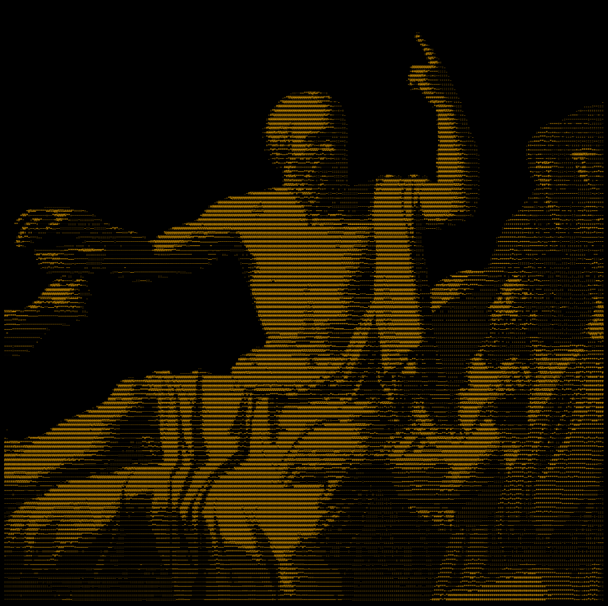
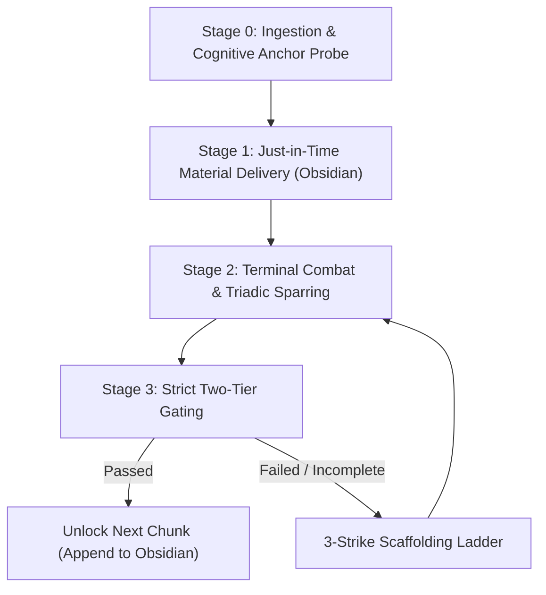

<p align="center">
  
</p>

# socrathinks

Socratic mastery learning system for technical and engineering subjects. Designed for AI coding assistants and runtimes, including Google Antigravity, Gemini CLI, Claude Code, and Codex.

Targeting Bloom Level 3 (*Apply*) and Level 4 (*Analyze*) competence, `socrathinks` turns an agent into an oral examiner and sparring partner. It pairs an external visuospatial scratchpad in Obsidian with freeform terminal combat, rejecting passive lecture dumps, multiple-choice quizzes, and ungrounded guessing games.

---

## The Problem and Motivation

### The Illusion of Competence

Passive reading creates a false sense of understanding. When a student reads a textbook derivation or watches an AI generate a step-by-step solution, the material feels straightforward because every individual step appears logical.

Cognitive psychology identifies this phenomenon as the *Illusion of Competence* (Karpicke, Butler, & Roediger, 2009; Bjork, 1994). Processing fluid explanations engages perirhinal recognition memory, which detects familiarity with previously encountered symbols. When an exam or lab environment removes the reference derivation, the student cannot reproduce the solution. Independent problem solving requires generative recollection through hippocampal and dorsolateral prefrontal pathways. Those pathways only develop when a student constructs derivations and proofs from scratch under constraint.

### Why Multiple-Choice Questions Fail in Engineering

Most interactive learning software relies on multiple-choice prompts. In quantitative engineering disciplines, multiple-choice questions create three distinct defects:

1. They test recognition rather than formulation. Students match patterns among visible options instead of constructing equations from physical laws.
2. They allow process-of-elimination guessing, rewarding students for ruling out impossible values instead of deriving correct ones.
3. They supply cues about order of magnitude, dimension, and variable relationships that real engineering problems never provide.

`socrathinks` bans multiple-choice interfaces during study sessions. Derivations, proofs, boundary limits, and circuit inspections must be stated as freeform mathematical expressions or written technical explanations directly in the chat interface.

### The Failure Mode of Standard Socratic Bots

Standard AI tutors attempt Socratic dialogue using Initiation-Response-Evaluation (IRE) patterns. The agent asks open-ended, ungrounded questions such as "What do you think happens to the current here?"

When the learner guesses wrong, the tutor responds with social steering: "Close, but think about the voltage." The exercise degenerates into an attempt to guess what the language model wants to hear.

`socrathinks` enforces **Triadic Questioning**. Questioning does not depend on tutor opinion. When the student makes an assertion, the examiner applies concrete boundary perturbations:
- Taking asymptotic limits ($R \to \infty, \omega \to 0, s \to \infty$).
- Inverting operating regimes (forcing transistors into saturation or triode).
- Introducing non-idealities (trace inductance, finite op-amp open-loop gain, thermal noise).

Objective physical conservation laws (Kirchhoff, Maxwell, Barkhausen, energy conservation) arbitrate the outcome.

### The Transient Information Effect in Chat Windows

In a single-window chat interface, equations, schematics, and definitions scroll off the screen as dialogue continues. Cognitive load theory defines this loss as the *Transient Information Effect* (Sweller, 2011).

Human working memory holds four chunks of novel information simultaneously (Cowan, 2001). When students must remember earlier algebraic states while evaluating a new circuit condition, working memory saturates. Problem solving degrades.

`socrathinks` resolves this limitation using a split-screen model based on the *Extended Mind Thesis* (Clark & Chalmers, 1998):
- **Obsidian Live Notes**: Acts as an external visuospatial scratchpad. It maintains the conceptual roadmap, governing equations, regime validity tables, and rendered schematics in a persistent pane.
- **Terminal Chat**: Serves as the interactive combat arena, preserving working memory for Socratic analysis and derivation.

---

## Cognitive Science Foundations

| Theory / Model | Origin | Operational Function in `socrathinks` |
|---|---|---|
| **Subsumption Theory** | David Ausubel (1968) | Stage 0 runs an explicit 2-question probe to find the student's existing mental schema before delivering any new concept. |
| **ICAP Framework** | Michelene Chi (2009) | Replaces passive reading and active note-taking with interactive cognitive sparring. |
| **Variation Theory** | Ference Marton (2006) | Tier 2 gating uses "twisted" problems, mutating surface features while keeping core physical principles invariant. |
| **Two-Sigma Tutoring Effect** | Benjamin Bloom (1984) | Replicates 1-on-1 mastery tutoring with strict gating requirements before advancing to new material. |
| **Cognitive Load Theory** | John Sweller (2011) | Eliminates transient information loss by offloading state representation to Obsidian. |

---

## System Architecture

```
┌────────────────────────────────────────────────────────┐     ┌────────────────────────────────────────────────────────┐
│                 TERMINAL CHAT PANE                     │     │                  OBSIDIAN LIVE NOTE                    │
│                 (The Combat Arena)                     │     │             (<Vault>\Lessons\<Topic>.md)               │
│                                                        │     │                                                        │
│ • Cognitive Anchor Interview                           │ ──> │ • Overarching Conceptual Roadmap (Mermaid)             │
│ • Freeform essay derivations & equation proofs         │     │ • Just-in-Time Compact Primers (Non-destructive)       │
│ • Triadic Adversarial Stress-Testing                   │     │ • Helicopter View with Analogy Retirement Clause       │
│ • 60-Second Discriminative Structural Drills           │     │ • Clean LaTeX equations & validity limits              │
│ • Twisted Non-Routine Problem Solves                   │     │ • High-resolution Python-rendered circuit PNGs         │
└────────────────────────────────────────────────────────┘     └────────────────────────────────────────────────────────┘
```

---

## The Four-Stage Operational Workflow



### Stage 0: Ingestion and the Cognitive Anchor Probe

When the user initiates a session with a topic, PDF slide deck, textbook chapter, or problem set, the agent:
1. Initializes the target Obsidian vault, verifies the `.obsidian` configuration, and opens `<Vault>/Lessons/<Topic>.md` in split screen.
2. Conducts a two-question interview in the terminal:
   - **The Anchor**: "Before we analyze [Topic], what related circuit, equation, or physical mechanism do you know cold?"
   - **The Litmus Test**: Asks a rapid technical question to confirm the anchor is solid.
3. Maps a 3- to 5-node dependency graph from that anchor to the target learning objective.

### Stage 1: Just-in-Time Material Delivery

The agent delivers instructional material in sequential chunks directly into the Obsidian note. It never overwrites previous sections. Each chunk adheres to a four-part structure:

1. **Helicopter View & Intuition**: One to two sentences providing physical intuition, paired with an explicit **Analogy Retirement Clause** stating where the analogy breaks down physically.
2. **The Cognitive Bridge**: Explains why the previous anchor failed, creating the engineering necessity for the new concept.
3. **Rigorous Engineering Core**: Detailed physical mechanics, governing differential and algebraic equations in LaTeX, and explicit boundary regimes where the model holds or collapses.
4. **Rendered Schematic**: Clear diagrams generated programmatically via Python (`schemdraw` or `matplotlib`) and stored in `<Vault>/Lessons/assets/circuits/`. ASCII circuit schematics are prohibited.

### Stage 2: Terminal Combat and Triadic Sparring

Once the primer is live in Obsidian, the student enters the terminal arena.
- The student states their derivation, hypothesis, or qualitative prediction.
- The agent launches boundary attacks:
  - Asymptotic limits: "You claim gain is $-g_m R_L$. What happens as $R_L \to \infty$? What physical mechanism limits the output?"
  - Frequency extremes: "Let $\omega \to \infty$. Does the capacitor behave as an open or short? Where does the feedback path redirect?"
  - Operating boundary inversions: "Calculate $V_{CE}$ when base current doubles. Does the transistor remain out of saturation?"
- Invariant physical laws determine validity.

### Stage 3: Strict Two-Tier Gating

The agent refuses to advance to the next chunk until the learner passes two gates:

#### Tier 1: The 60-Second Discriminative Structural Drill (Zero Calculation)
The student receives a new problem and must identify the regime, the optimal analytical method, and potential traps within 60 seconds without writing algebraic expansions. If the student writes algebra, the examiner halts the attempt.

#### Tier 2: The Twisted Problem Solve
The student solves a non-routine problem where surface attributes are inverted:
- Givens and targets are reversed.
- Non-ideal parasitics are introduced (source resistance, finite open-loop op-amp gain, nonzero ESR).
- Feedback topologies are redirected to internal nodes.

The student writes complete derivations and final equations in the terminal.

---

## The Five Cognitive Safeguards

1. **Analogy Retirement Clause**: Every physical intuition metaphor must declare where it fails. Metaphors are never used in place of mathematical derivations.
2. **3-Strike Progressive Scaffolding Ladder**: If a student is blocked during sparring, the agent intervenes systematically:
   - Strike 1: Highlights the physical contradiction.
   - Strike 2: Points to the active governing equation.
   - Strike 3: Provides the micro-worked transition step and requires the student to complete the derivation.
3. **First-Principles Equivalence Check**: Solutions are evaluated by dimensional homogeneity, topological validity, and mathematical equivalence rather than strict string matching.
4. **60-Second Drill Purity**: Algebra is banned during Tier 1 drills to isolate diagnostic recognition from computation.
5. **Tripartite Metacognitive Escape Hatch Contract**: A student cannot skip a chunk unless they document:
   - `[ESTABLISHED GROUND]`: Verified concepts they already command.
   - `[EXACT BOTTLENECK]`: The specific algebraic step or boundary condition causing the block.
   - `[STRUCTURAL HYPOTHESIS]`: A concrete hypothesis or administrative justification (e.g., syllabus boundary).

---

## Installation

### 1. Install into Your Agent Runtime

#### Antigravity / Gemini CLI
```bash
git clone https://github.com/stockfishZ/socrathinks.git ~/.gemini/config/skills/socrathinks
```

#### Claude Code
```bash
git clone https://github.com/stockfishZ/socrathinks.git ~/.claude/skills/socrathinks
```

#### Codex / AgentSkills Standard
```bash
git clone https://github.com/stockfishZ/socrathinks.git ~/.agents/skills/socrathinks
```

### 2. Install Python Dependencies

For schematic and diagram generation:
```bash
pip install schemdraw matplotlib
```

### 3. Optional: Configure Obsidian Vault Path

Set the `OBSIDIAN_VAULT_PATH` environment variable if your vault is located outside `~/Documents/ObsidianVault`:

```bash
# Linux / macOS
export OBSIDIAN_VAULT_PATH="$HOME/Documents/MyVault"

# Windows PowerShell
$env:OBSIDIAN_VAULT_PATH = "$HOME\Documents\MyVault"
```

---

## Usage

In your agent chat session, invoke the skill:

```
/socrathinks Small-Signal BJT Hybrid-Pi Model
```

Or supply an exam paper, lecture deck, or syllabus excerpt:

```
Use /socrathinks to take me through Chapter 7 of this textbook PDF. Hold the line on derivations.
```

The agent initializes your Obsidian split note, administers the Cognitive Anchor Probe, and opens terminal sparring.

---

## Repository Structure

```
socrathinks/
├── SKILL.md                          # Skill definition and agent instructions
├── README.md                         # Architecture, motivations, and usage guide
├── LICENSE                           # MIT License
├── assets/
│   └── cover.png                     # Visual banner
└── scripts/
    ├── sync-obsidian-lesson.ps1      # PowerShell Obsidian sync and URI launcher
    └── sync_obsidian_lesson.py       # Cross-platform Python sync and URI launcher
```

---

## License

MIT License. See [LICENSE](LICENSE) for details.
